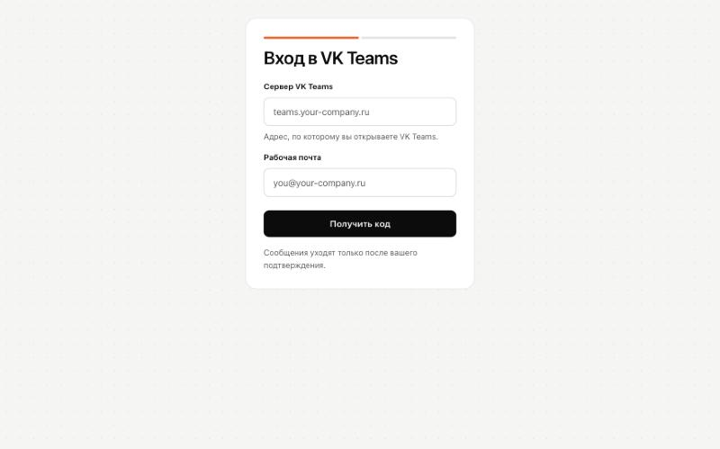

# VK Teams connector for AI agents

[Русский](README.md)

Free and open source (Apache-2.0). It lets an AI agent work in VK Teams or VK WorkSpace as one person:
chats, messages, people, files, call links and bots.

[](https://github.com/widmo-ru/vkteams-mcp/actions/workflows/ci.yml)
[](LICENSE)

## What it is and why

VK Teams has two APIs. The **Bot API** acts as a bot: it cannot read your chats, search your history
or write as you. The **client API** the VK Teams apps use can do all of that, but it is undocumented,
its paths depend on the server version, and its errors arrive as HTTP 200.

We measured the client API on a live server and built an MCP server on top of it. MCP, the Model
Context Protocol, is how an AI agent calls tools.

Two principles:

- **The smallest context for the agent.** 12 tools and about 4,100 tokens of catalogue by default
  (14 tools and about 4,800 tokens with group administration on; counted with the `o200k_base`
  tokenizer). Each tool answers one question a person asks.
- **Tools that carry the logic.** The server finds a chat or a person by name, turns an `@address`
  into a mention, picks the right one of four history and search methods, and moves files through
  links that expire in minutes, outside the model's context. It refuses what must not happen. We list
  every refusal in the requirements, and each has a test that fails when its guard is removed.

The server acts as one person, with their own VK Teams account, and nothing more. The
[manifesto](MANIFESTO.md) holds the rules review applies to every change.

## How it looks

The agent connects, and a sign-in page opens. The person types the VK Teams server, their work
e-mail and the code VK Teams e-mails them. Only this page sees the code; the model never does. The
page speaks the browser's language, Russian or English.



## What it does

| Tool | A person asks |
|---|---|
| `get_connection` | Am I connected, as whom, to which server? |
| `list_chats` | What is new? Which chats have unread messages? |
| `get_chat` | What is this chat, who is in it? |
| `update_chat` | Mark read, mute, archive, follow a thread, leave. |
| `list_messages` | What did people write here? Find the message about X. Which reactions, and how many? |
| `save_draft` → `send_draft` | Write: a draft first, sent only after a yes. Mentions, replies, polls, files, send later. |
| `update_message` | Fix, delete, pin, react, vote, close a poll, cancel a scheduled message. |
| `find_people` | Who is X? What is their address? |
| `download_file` | Get this attachment. |
| `save_call_link` | Make a link for a call or a webinar. |
| `respond_to_bot` | Start a bot, press its button. |
| `save_chat`, `update_chat_members` | Create or change a group, manage its members (off by default). |

Every tool's contract: [`docs/requirements.md`](docs/requirements.md).

## What it will not do

- Nothing reaches other people without a separate step. Sending takes two calls: a draft, then
  `send_draft`. Every action others see needs `user_confirmed: true`. The server cannot see the
  person agree: the agent sets the flag, so the MCP client should show such calls to the person.
- It cannot spam. One allowance per person: 10 actions at once, then one every 6 seconds. At most
  20 people per action, mentions included.
- Only your own messages change: edit and delete check the author first.
- Text written by others comes back inside markers with a one-time code, marked as data for the model;
  the server defangs a forged marker. The model never sees a bot's button data at all: a button is shown by
  number, the server assembles the press itself, and it refuses if the bot changed that button.
- Files never pass through the model. An attachment is a file name in the current folder, never a
  path, and the upload command runs curl with `--globoff`, so `{a,b}` cannot expand into another file.
- Some operations do not exist here: profile, status and nick changes, session resets, abuse
  reports, SMS, history wipes, privacy lists.

## Server security

| Rule | How |
|---|---|
| The model never sees the sign-in code | It is typed on this server's sign-in page only |
| A leaked database without the secret gives little | VK Teams sessions and drafts are sealed with AES-GCM; our tokens are stored as hashes |
| The sign-in page is not an attack tool | The server address must be the https name of a real VK Teams installation. The server checks every connection when it opens it, so by default no name can lead into a private network. The exception is `VKTEAMS_MCP_ALLOW_PRIVATE_NETWORKS=1` for a server inside a company network; then pin the installation in `VKTEAMS_MCP_INSTALLATIONS`. Code e-mails are rate-limited |
| OAuth 2.1 | Client registration, PKCE, one-hour access tokens, rotating refresh tokens; reusing an old one revokes the whole chain |
| Logs carry no content | A test runs a full message flow and fails if any text, address or `aimsid` appears in the logs |

## How it is tested

| Check | What it proves | Size |
|---|---|---|
| Unit tests (`pytest`) | Every tool against a fake VK Teams that answers the way a live server answered | over 400 |
| [Refusal map](docs/requirements.md) | Every "must refuse" row names an existing test | every row |
| Mutations (`scripts/mutation_check.py`) | Each rule is removed in turn and some test must fail | over 50 |
| Token budget (`python -m vkteams_mcp.budget --check`) | The default catalogue stays within its limit | every CI run |
| Surface lock (`tool-surface.lock.json`) | A changed argument or annotation is visible in review | every CI run |
| Purity (`tests/unit/test_gates.py`) | No forbidden name in any text file (the list is kept as hashes), no real chat id in the docs | every CI run |
| Live check | Every tool through OAuth on a real VK Teams server. Every defect three QA rounds found is fixed and held by a test ([scenarios and defects](docs/qa-scenarios.md), in Russian) | on demand |

## What we relied on

Sources, most trusted first:

1. **A live server.** We checked every request against a real VK Teams (API 139).
   [`docs/live-findings.md`](docs/live-findings.md) records what the server does. For example, `fromMsgId` in
   history excludes the message itself, and message ids exceed 2^53, so a JavaScript client rounds
   them when they are sent as numbers.
2. **The open-source [im-desktop](https://github.com/mail-ru-im/im-desktop)** (Apache-2.0, by VK). The
   desktop client: the session signature, group parameters, muting for good. We used it as a reference for request shapes.
3. **Unofficial API descriptions.** Where they disagree with the live server, the server wins.

A reference for the client API, with the signature formulas: [`CHEATSHEET.md`](CHEATSHEET.md).

## Connect

The server speaks Streamable HTTP with OAuth 2.1 (MCP authorization: client registration, PKCE,
rotating refresh tokens). In Claude, add it as a custom connector with its `/mcp` address; in
Claude Code:

```sh
claude mcp add --transport http vkteams https://vkteams-mcp.example.org/mcp
```

## Run it

A ready image for linux/amd64 and linux/arm64 is in the GitHub Container Registry; versions are in
[CHANGELOG.md](CHANGELOG.md) and on the [releases](https://github.com/widmo-ru/vkteams-mcp/releases) page.

```sh
openssl rand -base64 48 > vkteams-mcp.secret   # once; keep it: a new secret cannot open old sessions
docker run -p 127.0.0.1:8000:8000 -v vkteams-data:/data \
  -e VKTEAMS_MCP_PUBLIC_URL=https://vkteams-mcp.example.org \
  -e VKTEAMS_MCP_SECRET="$(cat vkteams-mcp.secret)" \
  ghcr.io/widmo-ru/vkteams-mcp:0.1.0
```

To build the image yourself: `docker build -t vkteams-mcp .`.

| Variable | Meaning |
|---|---|
| `VKTEAMS_MCP_PUBLIC_URL` | The https address clients reach this server on (required) |
| `VKTEAMS_MCP_SECRET` | At least 32 random characters; seals sessions and signs cursors (required; keep it) |
| `VKTEAMS_MCP_DATABASE` | SQLite file (default `vkteams-mcp.sqlite`; `/data/…` in the image) |
| `VKTEAMS_MCP_INSTALLATIONS` | Comma-separated VK Teams hosts this connector serves; with one host, the sign-in page asks only the e-mail |
| `VKTEAMS_MCP_ALLOW_PRIVATE_NETWORKS` | `1` when the server runs inside a company network next to its VK Teams |
| `VKTEAMS_MCP_AREAS` | Areas to publish (default all but `chat_admin`) |
| `VKTEAMS_MCP_TIMEZONE` | Time zone for times shown and for `send_at` (default `Europe/Moscow`) |
| `PORT` | Port inside the container (default 8000) |
| `VKTEAMS_MCP_DEV_ID` | VK Teams developer id (default: the desktop client's public one, from the open-source im-desktop) |

The container speaks plain HTTP on port 8000. Put a reverse proxy that terminates TLS for
`VKTEAMS_MCP_PUBLIC_URL` in front of it: OAuth and sign-in codes must travel over HTTPS.

Where state lives:

| Where | What | After a restart |
|---|---|---|
| SQLite in `/data` | VK Teams sessions and drafts (sealed), hashes of our OAuth tokens, registered clients | kept: sign-ins and drafts survive |
| process memory | each person's rate allowance, file links, the code step of the sign-in page, a one-minute chat list cache | lost |
| the MCP client | its own access and refresh tokens only | up to the client |

So the server runs as one replica. Two replicas would split the allowance between them and miss each
other's file links.

Most corporate VK Teams servers answer only inside the company network. Run the connector
there, pinned to that one installation, with `VKTEAMS_MCP_ALLOW_PRIVATE_NETWORKS=1`.

## Develop

```sh
uv sync
uv run pytest                            # unit tests against a fake VK Teams that records every request
uv run python scripts/mutation_check.py  # removes each guard in turn: its test must fail
uv run python -m vkteams_mcp.budget      # what the catalogue costs the model
uv run python -m vkteams_mcp.surface --check
```

The live suite (`tests/live`) talks to a real server and is run by hand.

## Documents

| Document | What it holds |
|---|---|
| [`MANIFESTO.md`](MANIFESTO.md) | The rules, each with what a violation looks like |
| [`docs/requirements.md`](docs/requirements.md) | Tool contracts and every refusal with its test |
| [`docs/live-findings.md`](docs/live-findings.md) | What a live VK Teams server does |
| [`docs/qa-scenarios.md`](docs/qa-scenarios.md) | QA scenarios per parameter, defects found and fixes (in Russian) |
| [`CHEATSHEET.md`](CHEATSHEET.md) | The VK Teams client API: sign-in, signature, calls, traps |
| [`SECURITY.md`](SECURITY.md) | How to report a vulnerability |
| [`CONTRIBUTING.md`](CONTRIBUTING.md) | How to make and check a change |

## Who made it

[Widmo](https://widmo.ru) deploys an AI platform inside a company's perimeter, connects it to the
company's systems and teaches teams to build their own agents. This connector is one part of it.

## Licence

[Apache-2.0](LICENSE).
