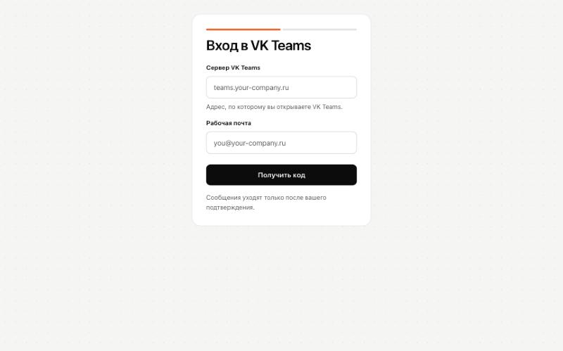

# Коннектор VK Teams для ИИ-агентов

[English](README.en.md)

Бесплатный, с открытым кодом (Apache-2.0). Даёт ИИ-агенту работать в VK Teams или VK WorkSpace от
имени одного человека: чаты, сообщения, люди, файлы, ссылки на звонки и боты.

[](https://github.com/widmo-ru/vkteams-mcp/actions/workflows/ci.yml)
[](LICENSE)

## Что это и зачем

У VK Teams два API. **Bot API** работает от имени бота: он не видит ваших чатов, не ищет по вашей
истории и не пишет от вашего имени. **Клиентский API**, которым пользуются приложения VK Teams, всё это
умеет. Но он не документирован, путь в нём зависит от версии сервера, а ошибки приходят с HTTP 200.

Мы проверили клиентский API на живом сервере, запрос за запросом, и построили поверх него MCP-сервер. Через MCP
(Model Context Protocol) ИИ-агент вызывает инструменты.

Два принципа:

- **Агенту минимум контекста.** 12 инструментов и около 4 100 токенов описаний по умолчанию
  (14 инструментов и около 4 800 токенов, если включить управление группами; токены посчитаны
  токенайзером `o200k_base`). Каждый инструмент отвечает на один вопрос человека.
- **Логику несут инструменты.** Сервер сам находит чат и человека по имени, превращает `@адрес` в
  упоминание, выбирает нужный из четырёх методов истории и поиска, передаёт файлы через ссылки на
  несколько минут, мимо контекста модели. И отказывает в том, чего делать нельзя. Каждый отказ мы
  внесли в требования и закрыли тестом, который падает, если убрать проверку.

Сервер действует как один человек, с его учётной записью VK Teams, и не больше. Правила, по которым
мы проверяем каждое изменение, лежат в [манифесте](MANIFESTO.md).

## Как это выглядит

Агент подключает коннектор, открывается страница входа. Человек вводит сервер VK Teams, рабочую почту
и код из письма. Код видит только эта страница, модель его не видит. Страница говорит на языке
браузера: по-русски или по-английски.



## Что умеет

| Инструмент | Вопрос человека |
|---|---|
| `get_connection` | Я подключён? Под кем, к какому серверу? |
| `list_chats` | Что нового? Где непрочитанное? |
| `get_chat` | Что это за чат, кто в нём? |
| `update_chat` | Отметить прочитанным, выключить звук, архивировать, следить за веткой, выйти. |
| `list_messages` | Что писали? Найди сообщение про X. Какие реакции и сколько? |
| `save_draft` → `send_draft` | Написать: сначала черновик, отправка только после «да». Упоминания, ответ цитатой, опрос, файлы, отправка по расписанию. |
| `update_message` | Исправить, удалить, закрепить, поставить реакцию, проголосовать, закрыть опрос, отменить отложенное. |
| `find_people` | Кто это? Какой у него адрес? |
| `download_file` | Скачай вложение. |
| `save_call_link` | Сделай ссылку на звонок или вебинар. |
| `respond_to_bot` | Запусти бота, нажми его кнопку. |
| `save_chat`, `update_chat_members` | Создать или изменить группу, управлять участниками (по умолчанию выключено). |

Контракты всех инструментов: [`docs/requirements.md`](docs/requirements.md).

## Чего не делает

- Ничего не уходит людям без отдельного шага. Отправка двухшаговая: черновик, затем `send_draft`.
  Каждое действие, которое видят другие, требует `user_confirmed: true`. Сервер не видит, как человек
  соглашается: флаг ставит агент, поэтому MCP-клиент должен показывать такие вызовы человеку.
- Нельзя заспамить. Один лимит на человека: 10 действий сразу, затем одно в 6 секунд. Не больше
  20 человек на действие, включая упоминания.
- Меняются только свои сообщения: правка и удаление проверяют автора.
- Текст других людей приходит в метках с одноразовым кодом: модель видит, что это данные.
  Поддельную метку сервер обезвреживает. Данные кнопок бота модель не видит вовсе: кнопка показывается
  номером, а нажатие сервер собирает сам и отказывает, если бот успел поменять кнопку.
- Файлы не проходят через модель. Вложение задаётся именем файла в текущей папке, путь не принимается. Команда
  загрузки запускает curl с `--globoff`, чтобы `{a,b}` не раскрылось в чужой файл.
- Некоторых операций здесь нет совсем: смена профиля, статуса и ника, сброс сессий, жалобы, SMS, очистка
  истории, списки приватности.

## Безопасность сервера

| Правило | Как |
|---|---|
| Код входа не видит модель | Его вводят только на странице входа этого сервера |
| Утечка базы без секрета почти ничего не даёт | Сессии VK Teams и черновики зашифрованы AES-GCM, наши токены лежат в базе только как хеши |
| Страница входа не становится инструментом атаки | Адрес сервера — только https-имя настоящей инсталляции VK Teams. Сервер проверяет каждое соединение при открытии, поэтому по умолчанию никакое имя не ведёт во внутреннюю сеть. Исключение: `VKTEAMS_MCP_ALLOW_PRIVATE_NETWORKS=1` для установки внутри сети компании, и тогда инсталляцию закрепляют в `VKTEAMS_MCP_INSTALLATIONS`. Письма с кодом ограничены по частоте |
| OAuth 2.1 | Регистрация клиента, PKCE, токен доступа на час, ротация refresh-токена; повторное использование старого отзывает всю цепочку |
| Логи без содержимого | Тест проходит весь сценарий переписки и падает, если в логах есть текст, адрес или `aimsid` |

## Как проверено

| Проверка | Что доказывает | Объём |
|---|---|---|
| Юнит-тесты (`pytest`) | Каждый инструмент против фейка VK Teams, который отвечает так же, как отвечал живой сервер | больше 400 |
| [Карта отказов](docs/requirements.md) | Каждая строка «обязан отказать» ссылается на существующий тест | каждая строка |
| Мутации (`scripts/mutation_check.py`) | Каждое правило убирается по очереди, и какой-то тест обязан упасть | больше 50 |
| Бюджет токенов (`python -m vkteams_mcp.budget --check`) | Каталог по умолчанию не выходит за лимит | каждый запуск CI |
| Фиксация интерфейса инструментов (`tool-surface.lock.json`) | Изменённый аргумент или аннотация видны в ревью | каждый запуск CI |
| Чистота (`tests/unit/test_gates.py`) | В текстовых файлах нет запрещённых имён (список хранится хешами), в документах нет настоящих id чатов | каждый запуск CI |
| Живая проверка | Все инструменты через OAuth на настоящем сервере VK Teams. Каждый дефект, найденный за три раунда QA, исправлен и закрыт тестом ([сценарии и дефекты](docs/qa-scenarios.md)) | по требованию |

## На что мы опирались

Источники по убыванию доверия:

1. **Живой сервер.** Мы сверили каждый запрос с настоящим VK Teams (API 139). Что сервер делает,
   описано в [`docs/live-findings.md`](docs/live-findings.md). Например, `fromMsgId` в истории
   не включает само сообщение, а id сообщений больше 2^53, и JavaScript-клиент их округляет, если
   передать числом.
2. **Открытый код [im-desktop](https://github.com/mail-ru-im/im-desktop)** (Apache-2.0, от VK). Десктопный
   клиент: подпись сессии, параметры групп, бессрочное выключение звука. Мы сверялись с ним как со справочником по форме запросов.
3. **Неофициальные описания API.** Там, где они расходятся с живым сервером, прав сервер.

Справочник по клиентскому API с формулами подписи: [`CHEATSHEET.md`](CHEATSHEET.md).

## Подключение

Сервер работает по Streamable HTTP с OAuth 2.1 (авторизация MCP: регистрация клиента, PKCE, ротация
refresh-токенов). В Claude его добавляют как свой коннектор с адресом `/mcp`, в Claude Code так:

```sh
claude mcp add --transport http vkteams https://vkteams-mcp.example.org/mcp
```

## Запуск

```sh
openssl rand -base64 48 > vkteams-mcp.secret   # один раз; храните: новый секрет не откроет старые сессии
docker build -t vkteams-mcp .
docker run -p 127.0.0.1:8000:8000 -v vkteams-data:/data \
  -e VKTEAMS_MCP_PUBLIC_URL=https://vkteams-mcp.example.org \
  -e VKTEAMS_MCP_SECRET="$(cat vkteams-mcp.secret)" \
  vkteams-mcp
```

| Переменная | Значение |
|---|---|
| `VKTEAMS_MCP_PUBLIC_URL` | https-адрес, по которому клиенты видят сервер (обязательно) |
| `VKTEAMS_MCP_SECRET` | Не меньше 32 случайных символов: шифрует сессии и подписывает курсоры (обязательно, храните) |
| `VKTEAMS_MCP_DATABASE` | Файл SQLite (по умолчанию `vkteams-mcp.sqlite`, в образе `/data/…`) |
| `VKTEAMS_MCP_INSTALLATIONS` | Хосты VK Teams через запятую, которые обслуживает коннектор. С одним хостом страница входа спрашивает только почту |
| `VKTEAMS_MCP_ALLOW_PRIVATE_NETWORKS` | `1`, если сервер стоит внутри сети компании рядом с её VK Teams |
| `VKTEAMS_MCP_AREAS` | Какие области включить (по умолчанию все, кроме `chat_admin`) |
| `VKTEAMS_MCP_TIMEZONE` | Часовой пояс для времени в ответах и в `send_at` (по умолчанию `Europe/Moscow`) |
| `PORT` | Порт внутри контейнера (по умолчанию 8000) |
| `VKTEAMS_MCP_DEV_ID` | developer id VK Teams (по умолчанию публичный id десктопного клиента из открытого im-desktop) |

Контейнер работает по HTTP на порту 8000. Поставьте перед ним обратный прокси с TLS на адрес
`VKTEAMS_MCP_PUBLIC_URL`: OAuth и коды входа должны идти по HTTPS. Нужна одна реплика: лимиты и ссылки
на файлы сервер держит в памяти.

Большинство корпоративных серверов VK Teams отвечают только внутри сети компании. Тогда коннектор ставят
туда же, закрепляют за одной инсталляцией и включают `VKTEAMS_MCP_ALLOW_PRIVATE_NETWORKS=1`.

## Разработка

```sh
uv sync
uv run pytest                            # юнит-тесты против фейка VK Teams, который записывает каждый запрос
uv run python scripts/mutation_check.py  # убирает каждое правило по очереди: его тест обязан упасть
uv run python -m vkteams_mcp.budget      # сколько каталог стоит модели
uv run python -m vkteams_mcp.surface --check
```

Живые тесты (`tests/live`) ходят на настоящий сервер и запускаются вручную.

## Документы

| Документ | Что в нём |
|---|---|
| [`MANIFESTO.md`](MANIFESTO.md) | Правила; у каждого описано, как выглядит нарушение |
| [`docs/requirements.md`](docs/requirements.md) | Контракты инструментов и все отказы с тестами |
| [`docs/live-findings.md`](docs/live-findings.md) | Что делает живой сервер VK Teams |
| [`docs/qa-scenarios.md`](docs/qa-scenarios.md) | Сценарии QA по каждому параметру, найденные дефекты и исправления |
| [`CHEATSHEET.md`](CHEATSHEET.md) | Клиентский API VK Teams: вход, подпись, вызовы, ловушки |
| [`SECURITY.md`](SECURITY.md) | Как сообщить об уязвимости |
| [`CONTRIBUTING.md`](CONTRIBUTING.md) | Как сделать и проверить изменение |

## Кто сделал

[Widmo](https://widmo.ru) разворачивает ИИ-платформу внутри периметра компании, подключает её к
системам компании и учит команды делать своих агентов. Этот коннектор — одна из её частей.

## Лицензия

[Apache-2.0](LICENSE).
