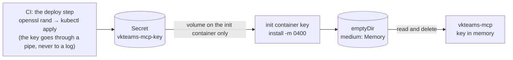
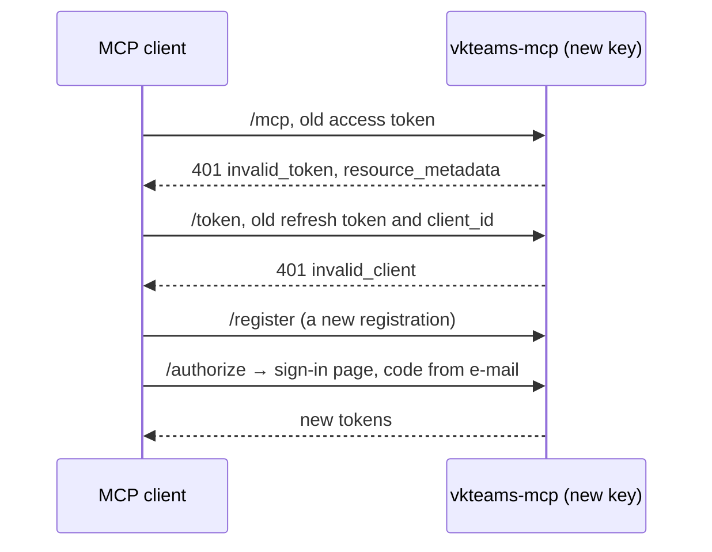

English | [Русский](README.md)

# Deploying on Kubernetes

The key the server seals sessions with lives only in the process's memory. The server's container holds it
in no environment variable and no file: `kubectl exec … env` and `ls` do not show it.



| Where | Holds the key? |
|---|---|
| Secret `vkteams-mcp-key` | yes: CI writes it on every deploy |
| init container `key` | yes, while it copies, then it exits |
| emptyDir `/run/vkteams-mcp` | only until the server starts: it reads the file and deletes it |
| the server container's `env` | no: no `env` or `envFrom` with the key |
| the server process's memory | yes, and only there |

## What a deploy does

| Event | Key | People |
|---|---|---|
| a deploy (a new key in the Secret) | new | **everyone is signed out, once**: old tokens get 401 and the client signs in again |
| a pod restarted or rescheduled without a deploy | the same: the init container copies the same Secret | stay signed in |
| a container restarted inside the same pod | the file is gone | the server does not start and says to delete the pod: `kubectl delete pod …` |

That is why the example has no `livenessProbe`: it would restart the container inside the pod, not the pod.

Any number of replicas can run: every pod of one deploy reads the same Secret. `strategy: Recreate` keeps two
keys from serving at once during a rollout: with `RollingUpdate` a token from a new pod meets an old pod and
gets 401.

## What signing out after a deploy looks like



A client that does not register again on `invalid_client` sends the person to its old registration. The
browser then shows the "Connect again" page: clear the connector's authorization in the AI app and connect again.

## Files

| File | What it is |
|---|---|
| [`kubernetes/deployment.yaml`](kubernetes/deployment.yaml) | the Deployment with its init container, and a Service |
| [`kubernetes/new-key.sh`](kubernetes/new-key.sh) | the deploy step for any CI: a new key in the Secret and a restart of the pods |
| [`helm/secret.yaml`](helm/secret.yaml) | the same Secret for a Helm or werf chart: a new key on every render |

## Any CI

Deploying the image does not change the key by itself: add the `new-key.sh` step to your deploy pipeline,
right after the manifests are applied.

```sh
kubectl -n vkteams apply -f deploy/kubernetes/deployment.yaml
NAMESPACE=vkteams deploy/kubernetes/new-key.sh
```

`new-key.sh` hands the key from `openssl` to the Kubernetes API through the shell's memory and a pipe: it is in
no file, no process's arguments and no log; it turns tracing (`sh -x`) off and does not print `kubectl`'s errors,
which can quote the Secret. It writes the Secret by server-side apply, without the `last-applied-configuration`
annotation in which a plain `kubectl apply` keeps a second copy of the key. There is nothing to mask. If your CI does put the key in a variable, declare it secret
(masked in GitLab, `::add-mask::` in GitHub Actions).

## Helm and werf

Put [`helm/secret.yaml`](helm/secret.yaml) in `templates/` next to the Deployment and add to its pod template:

```yaml
  template:
    metadata:
      annotations:
        checksum/vkteams-mcp-key: {{ include "vkteams-mcp.keyChecksum" . }}
```

`randAlphaNum 64` makes the key on every render, so every `helm upgrade` or `werf converge` is a new key, and
the changed annotation restarts the pods. The key passes through no values file, no `--set` and no CI log.
`helm template` and `werf render` print it, as they print any Secret: keep their output out of logs. Helm's and
werf's release history (the `sh.helm.release.v1.*` Secrets) keeps the key of every past deploy; the same people
who can read Secrets in the namespace can read it. `--history-max` limits how far back it goes.

## Moving from `VKTEAMS_MCP_SECRET`

| Version | `VKTEAMS_MCP_SECRET` in env |
|---|---|
| 0.2.x | required |
| 0.3.x | used when there is no key file, with a warning in the log; ignored when there is one |
| the next minor release | the server refuses to start |

Upgrading the image without changing the manifests neither crashes the server nor signs anyone out. Moving to
the init container is the first deploy with a new key: everyone is signed out once.

## When the server does not start

| Log line | Cause | What to do |
|---|---|---|
| `no sealing key: /run/vkteams-mcp/key does not exist` | the container restarted inside the same pod (the file was read and deleted), or there is no init container | `kubectl delete pod <pod>`: a new pod copies the same key; with no init container, add it |
| `the sealing key in … could not be deleted` | the Secret is mounted straight into the server's container, read-only | the Secret goes to the init container only; the server gets an emptyDir with `medium: Memory` |
| `the sealing key in … could not be read` | a directory at the path, or no read permission | check `install -m 0400` and `fsGroup: 10001` |
| `the sealing key must be at least 32 random characters` | the Secret is empty or the key is short | run `new-key.sh` again |
| `the sealing key in … is not text` / `is longer than 4096 bytes` | the wrong file in the Secret | run `new-key.sh` again |
| `VKTEAMS_MCP_SECRET is deprecated …` (a warning) | the key still comes as a variable | move to the init container and remove the variable |
| `VKTEAMS_MCP_SECRET is ignored: the key comes from …` (a warning) | both the file and the variable are there; the file wins | remove the variable: `kubectl exec … env` still shows it |

Why the pod does not recover by itself: Kubernetes restarts a failed container but not its init container.
Recovering the key inside the pod would mean keeping it where `kubectl exec` sees it, which is exactly what this
arrangement prevents. The cost: when the process dies (an OOM kill included) the pod stays in CrashLoopBackOff
until it is deleted. Alert on container restarts.

One more window: between a new key landing in the Secret and the pods restarting, a pod that restarts on its
own picks up the new key early. If `kubectl apply` changed the pod template, its rollout may run while
`new-key.sh` writes the Secret, and pods may briefly hold different keys. `new-key.sh` restarts right away, and
`Recreate` stops every old pod first: after it, all pods share one key. This happens inside a deploy, which signs
everyone out anyway.

## What remains

| Threat | Closed? |
|---|---|
| the key in `kubectl exec … env`, in `ls`, in logs | yes, by this arrangement |
| the key in the Secret: whoever may `get secrets` in the namespace reads it | no: that is the cluster's RBAC, the cluster owner's side |
| `pods/exec` as the same user can read the process's memory | no: that is access to the process itself |
