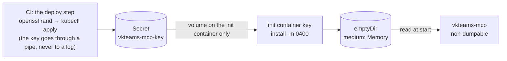
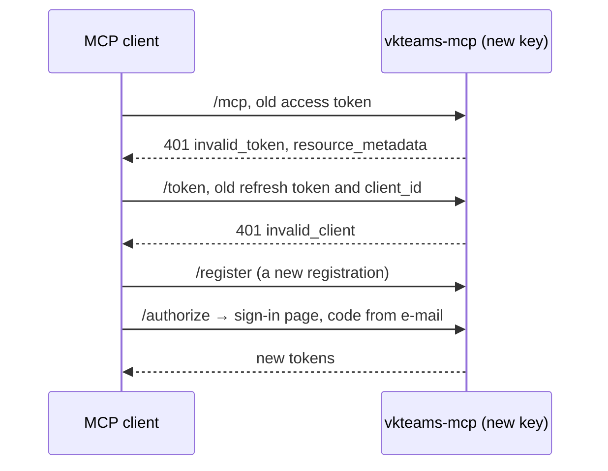

English | [Русский](README.md)

# Deploying on Kubernetes

The key the server seals sessions with is in no environment variable and no log: `kubectl exec … env` does not
show it. In the server's container it sits in one memory-backed file (emptyDir `medium: Memory`), mode 0400 for
the server's user only, and the process is closed to memory reads (`PR_SET_DUMPABLE=0`).



| Where | Holds the key? |
|---|---|
| Secret `vkteams-mcp-key` | yes: CI writes it on every deploy |
| init container `key` | yes, while it copies, then it exits |
| emptyDir `/run/vkteams-mcp/key` | yes: 0400, owned by uid 10001; the file stays, so a container restart keeps sessions |
| a Secret volume in the server's container | no: the Secret is mounted into the init container only |
| the server container's `env` | no: no `env` or `envFrom` with the key |
| logs | no |
| the server process's memory | yes; another process of the same user cannot read it (non-dumpable) |

## What a deploy does

| Event | Key | People |
|---|---|---|
| a deploy (a new key in the Secret) | new | **everyone is signed out, once**: old tokens get 401 and the client signs in again |
| a pod restarted or rescheduled without a deploy | the same: the init container copies the same Secret | stay signed in |
| a container restarted inside the pod (OOM, a crash, `livenessProbe`) | the same file in the emptyDir | stay signed in |

Any number of replicas can run: every pod of one deploy reads the same Secret. `strategy: Recreate` keeps two
keys from serving at once during a rollout: with `RollingUpdate` a token from a new pod meets an old pod and
gets 401.

## What signing out after a deploy looks like



A client that does not register again on `invalid_client` sends the person to its old registration. The
browser then shows the "Connect again" page: clear the connector's authorization in the AI app and connect again.

## Files

| File | What it is |
|---|---|
| [`kubernetes/deployment.yaml`](kubernetes/deployment.yaml) | the Deployment with its init container, and a Service |
| [`kubernetes/new-key.sh`](kubernetes/new-key.sh) | the deploy step for any CI: a new key in the Secret and a restart of the pods |
| [`helm/secret.yaml`](helm/secret.yaml) | the same Secret for a Helm or werf chart: a new key on every render |

## Any CI

Deploying the image does not change the key by itself: add the `new-key.sh` step to your deploy pipeline,
right after the manifests are applied.

```sh
kubectl -n vkteams apply -f deploy/kubernetes/deployment.yaml
NAMESPACE=vkteams deploy/kubernetes/new-key.sh
```

`new-key.sh` hands the key from `openssl` to the Kubernetes API through the shell's memory and a pipe: it is in
no file, no process's arguments and no log; it turns tracing (`sh -x`) off and does not print `kubectl`'s errors,
which can quote the Secret. It writes the Secret by server-side apply, without the `last-applied-configuration`
annotation in which a plain `kubectl apply` keeps a second copy of the key. There is nothing to mask. If your CI does put the key in a variable, declare it secret
(masked in GitLab, `::add-mask::` in GitHub Actions).

## Helm and werf

Put [`helm/secret.yaml`](helm/secret.yaml) in `templates/` next to the Deployment and add to its pod template:

```yaml
  template:
    metadata:
      annotations:
        checksum/vkteams-mcp-key: {{ include "vkteams-mcp.keyChecksum" . }}
```

`randAlphaNum 64` makes the key on every render, so every `helm upgrade` or `werf converge` is a new key, and
the changed annotation restarts the pods. The key passes through no values file, no `--set` and no CI log.
`helm template` and `werf render` print it, as they print any Secret: keep their output out of logs. Helm's and
werf's release history (the `sh.helm.release.v1.*` Secrets) keeps the key of every past deploy; the same people
who can read Secrets in the namespace can read it. `--history-max` limits how far back it goes.

## Moving from `VKTEAMS_MCP_SECRET`

| Version | `VKTEAMS_MCP_SECRET` in env |
|---|---|
| 0.2.x | required |
| 0.3.x | used when there is no key file, with a warning in the log; ignored when there is one |
| the next minor release | the server refuses to start |

Upgrading the image without changing the manifests neither crashes the server nor signs anyone out. Moving to
the init container is the first deploy with a new key: everyone is signed out once.

## When the server does not start

| Log line | Cause | What to do |
|---|---|---|
| `no sealing key: /run/vkteams-mcp/key does not exist` | no init container or emptyDir | add them, as in `deployment.yaml` |
| `the sealing key in … is readable by others` | the group or everyone can read the file: say, the Secret is mounted straight into the container (`defaultMode` 0440/0644) | the Secret goes to the init container only; `install -m 0400` writes the file |
| `the sealing key in … is not a regular file` | a directory, FIFO or device at the path | the init container writes the file: `install -m 0400 /secret/key /run/vkteams-mcp/key` |
| `the sealing key in … belongs to uid …` | the init container ran as another user than the server | `runAsUser: 10001` at the pod level, as in `deployment.yaml` |
| `the process could not be made non-dumpable … not starting` | the kernel or a seccomp profile refused `prctl(PR_SET_DUMPABLE)` | allow `prctl` in the seccomp profile (`RuntimeDefault` allows it) |
| `the sealing key in … could not be read` | a directory at the path, or no read permission | check `install -m 0400` and `fsGroup: 10001` |
| `the sealing key must be at least 32 random characters` | the Secret is empty or the key is short | run `new-key.sh` again |
| `the sealing key in … is not text` / `is longer than 4096 bytes` | the wrong file in the Secret | run `new-key.sh` again |
| `could not write secret/…` (in CI, from `new-key.sh`) | the API refused or did not answer in time; `kubectl`'s message is hidden, it can quote the key | check access and the connection: `kubectl -n vkteams auth can-i patch secret/vkteams-mcp-key`. After a timeout the Secret may have changed: run `new-key.sh` again |
| `secret/… still has a last-applied-configuration annotation` (from `new-key.sh`) | the annotation with an older copy of the key could not be removed; the pods were not restarted | `kubectl -n vkteams annotate secret vkteams-mcp-key kubectl.kubernetes.io/last-applied-configuration-`, then run `new-key.sh` again |
| `VKTEAMS_MCP_SECRET is deprecated …` (a warning) | the key still comes as a variable | move to the init container and remove the variable |
| `VKTEAMS_MCP_SECRET is ignored: the key comes from …` (a warning) | both the file and the variable are there; the file wins | remove the variable: `kubectl exec … env` still shows it |

One more window: between a new key landing in the Secret and the pods restarting, a pod that restarts on its
own picks up the new key early. If `kubectl apply` changed the pod template, its rollout may run while
`new-key.sh` writes the Secret, and pods may briefly hold different keys. `new-key.sh` restarts right away, and
`Recreate` stops every old pod first: after it, all pods share one key. This happens inside a deploy, which signs
everyone out anyway.

## Live proof (not yet run)

Proven live on 2026-11-18 on the published 0.3.0 image (`sha256:8a10645f…`) in a kind cluster: no key in
`env` or logs (searched by value), the key file `-r-------- 10001`, `/proc/1/environ` refused to the same user,
no Secret volume in the server's container. To repeat it: `kubectl exec <pod> -c vkteams-mcp -- env`,
`… -- ls -ln /run/vkteams-mcp`, `… -- cat /proc/1/environ`, and
`kubectl get pod <pod> -o jsonpath='{.spec.containers[*].volumeMounts[*].name}'`.
**Not yet run** against a real VK Teams server: a signed-in session surviving a container restart, then 401
after a new key. It needs a person to sign in twice with an e-mailed code.

| Step | Command | Expect |
|---|---|---|
| 1 | `kind create cluster --name vkkey`; `kubectl create ns vkkey` | |
| 2 | the commands below the table: the manifest with a local address, one replica, the VK Teams host | |
| 3 | `NAMESPACE=vkkey deploy/kubernetes/new-key.sh` | rollout done |
| 4 | `kubectl -n vkkey port-forward deploy/vkteams-mcp 8795:8000` | |
| 5 | `uv run python tests/live/e2e_oauth.py login http://localhost:8795`, sign in with the e-mailed code | `token saved` |
| 6 | `uv run python tests/live/e2e_oauth.py call http://localhost:8795 list_chats '{}'` | chats |
| 7 | `kubectl -n vkkey exec deploy/vkteams-mcp -c vkteams-mcp -- kill 1`; wait for `RESTARTS 1` | same pod |
| 8 | restart the port-forward (it drops with the container), then step 6 again | chats, no sign-in: **the session survived** |
| 9 | `NAMESPACE=vkkey deploy/kubernetes/new-key.sh`, restart the port-forward | new pod |
| 10 | `curl -si -H "Authorization: Bearer <access_token from ~/.config/vkteams-mcp/e2e-token.json>" -X POST http://localhost:8795/mcp` | `401`, `WWW-Authenticate: … error="invalid_token" … resource_metadata=` |
| 11 | steps 5 and 6 | a second sign-in works |
| 12 | `kind delete cluster --name vkkey` | |

Step 2, with `<host>` the VK Teams server's host name:

```sh
sed -e 's#value: https://vkteams-mcp.example.org#value: "http://localhost:8795"#' -e 's#replicas: 2#replicas: 1#' \
  deploy/kubernetes/deployment.yaml | kubectl -n vkkey apply -f -
kubectl -n vkkey set env deploy/vkteams-mcp VKTEAMS_MCP_ALLOW_PRIVATE_NETWORKS=1 VKTEAMS_MCP_INSTALLATIONS=<host>
```

`e2e_oauth.py` overwrites `~/.config/vkteams-mcp/e2e-token.json`: copy it aside first.

## What remains

| Threat | Closed? |
|---|---|
| the key in `kubectl exec … env`, in logs | yes: the key is in no variable and no log |
| the key in a Secret volume of the server's container | yes: the Secret is mounted into the init container only |
| the process's memory through `/proc/<pid>/mem` or ptrace from another process of the same user | yes: the process is non-dumpable; on Linux the server does not start without it. Check: `kubectl exec <pod> -c vkteams-mcp -- cat /proc/1/environ` answers `Permission denied` |
| `kubectl exec` into the server's container: `cat /run/vkteams-mcp/key` (the same uid) | **no**: RBAC on `pods/exec`, the cluster owner's side, closes it |
| the key in the Secret: whoever may `get secrets` in the namespace reads it | **no**: RBAC on `secrets`, the cluster owner's side |
