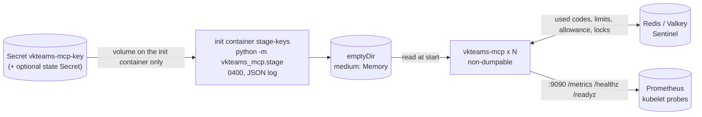

English | [Русский](README.md)

# Deploying on Kubernetes

The chart [`charts/vkteams-mcp`](../charts/vkteams-mcp/README.md) runs the server with **many replicas**, a shared
state store (Redis or Valkey, standalone or behind Sentinel), JSON logs, Prometheus metrics on a port of their own,
and the sealing key delivered the way 0.3.0 introduced: in no environment variable and no log.

```sh
helm upgrade --install vkteams-mcp oci://ghcr.io/widmo-ru/charts/vkteams-mcp --version 0.4.0 -n vkteams -f values.yaml
```

```yaml
# values.yaml: the least that works
publicUrl: https://vkteams-mcp.example.org
key:
  existingSecret: vkteams-mcp-key      # you own it; scripts/new-sealing-key.sh makes one
state:
  sentinel: {hosts: ["redis-sentinel:26379"], master: mymaster}   # or: url: redis://redis:6379/0
vkteams:
  installations: [teams.example.org]   # pin the connector to your VK Teams
```



## The sealing key

| Where | Holds the key? |
|---|---|
| Secret (`key.existingSecret`, field `key`) | yes: a Secret you own |
| init container `stage-keys` | yes, while it copies, then it exits |
| emptyDir `/run/vkteams-mcp/key` | yes: 0400, owned by uid 10001; the file stays, so a container restart keeps sessions |
| a Secret volume in the server's container | no: the Secret is mounted into the init container only |
| the server container's `env` | no |
| logs | no |
| the server process's memory | yes; another process of the same user cannot read it (non-dumpable) |

**The key is stable.** It does not change on a deploy: it is the same Secret for every release, so a rolling update
(`maxUnavailable: 0`, `maxSurge: 1`) serves old and new pods side by side with one key, and nobody is signed out.
This is a change from 0.3.x, whose Helm snippet drew a new random key on every render. Put the Secret where your
secrets live (a werf secret value, a sealed or external secret) or make one with
`scripts/new-sealing-key.sh <namespace> <secret>`, which prints a revision id for `key.revision`.

**Rotating the key** is a separate, deliberate operation: write the new value into the Secret and set a new
`key.revision` (this restarts every pod through a pod annotation). Everyone signs in again; while the rollout
runs, a token sealed by a new-key pod is refused by an old-key pod, so a client may be refused more than once until the
rollout is over: reconnect after it completes. The server takes one key, not a previous one
alongside: a rollout is the whole overlap.

| Event | People |
|---|---|
| a deploy with the same key | stay signed in |
| a pod restarted or rescheduled | stay signed in |
| a container restarted inside the pod | stay signed in |
| the key rotated | **signed out**: old tokens get 401 `invalid_token`; reconnect once the rollout is over |

## The state store

Authorization stays stateless: sessions, drafts, file links travel sealed inside what the client holds. The store holds
only what must be refused the second time wherever it lands:

| What | Key lives | Value |
|---|---|---|
| a redeemed authorization code | 5 minutes | `1` |
| sign-in code requests per address and per network (3 and 10 an hour) | 1 hour | timestamps |
| code submissions per sign-in step (5; every submission counts, wrong or met by an upstream error) | 15 minutes | a number |
| the send allowance per person (10 at once, 10 a minute) | until full again | a number and a time |
| an upload link while an upload of it runs | 10 minutes | a lock token |

**Nothing in it is readable.** Every key is `<prefix><kind>:<HMAC-SHA256 of the value under a sub-key of the sealing
key>`: no login, address or IP appears, even to someone who can read the store. Values are numbers, timestamps and
random tokens. Every key has a TTL. Run the store with **`maxmemory-policy noeviction`**: an evicted key would lift a
limit; a write the store refuses for lack of memory is a store error and fails closed. The store may have no password
and no TLS (inside the platform network); when it has, the password comes from a file.

| Setting | Chart | Environment |
|---|---|---|
| one Redis or Valkey | `state.url: redis://host:6379/0` (or `rediss://`) | `VKTEAMS_MCP_STATE_URL` |
| Sentinel | `state.sentinel.hosts: [h1:26379, …]`, `.master: mymaster` (one host is valid) | `VKTEAMS_MCP_STATE_SENTINELS`, `VKTEAMS_MCP_STATE_SENTINEL_MASTER` |
| database, TLS, ACL user | `state.db` (Sentinel; with a URL the database is its path), `state.tls`, `state.username` | `VKTEAMS_MCP_STATE_DB`, `VKTEAMS_MCP_STATE_TLS`, `VKTEAMS_MCP_STATE_USERNAME` |
| passwords | `state.existingSecret` with keys `password`, `sentinelPassword` | `VKTEAMS_MCP_STATE_PASSWORD_FILE`, `VKTEAMS_MCP_STATE_SENTINEL_PASSWORD_FILE` |
| key prefix | `state.prefix` (default `vkteams:`) | `VKTEAMS_MCP_STATE_PREFIX` |

A URL together with Sentinels is a configuration error, and so is a password in the URL. The password files are
staged by the same init container as the key, into the same memory volume, with the same checks (a regular file,
owner-only, the server's uid, at most 1 KiB). Nothing set: memory, which is right for **one** replica; the chart
refuses more (`replicaCount > 1` or autoscaling without a store) and deploys with `Recreate` (two pods with separate memories
must never serve together, so a deploy has a short gap and the marks of the old pod are lost); the server logs a warning
at start. A store gives both zero-downtime rollouts and state that survives a deploy.

**When the store is down:** sign-in, spending a code and sending fail closed with "try again shortly" (the person is not
let through without the limit); reading and listing go on. Readiness does **not** depend on the store (one outage
would empty the Service): `mcp_state_store_up` goes to 0 (set an alert on it). A Sentinel
failover is followed without a restart: connections time out after 1 second and the master is looked up again.

## Probes, metrics, ingress

| Port | Serves | Public? |
|---|---|---|
| 8000 | `/mcp`, OAuth, `/signin`, `/files/…`, `/healthz`, `/readyz` | through the ingress paths only |
| 9090 (`metrics.port`) | `/metrics`, `/healthz`, `/readyz` | no: pods only |

The kubelet probes use port 9090. `/metrics` is not on the public port (404). The ingress lists explicit paths
(`ingress.paths`): `/mcp`, `/.well-known/`, `/authorize`, `/token`, `/register`, `/revoke`, `/signin`, `/static/`,
`/files/`; `/` is refused by the chart.

Metrics, all with the label `server="vkteams"`: `mcp_http_requests_in_flight{route_group}`,
`mcp_http_requests_total`, `mcp_http_request_duration_seconds`, `mcp_tool_calls_total`, `mcp_tool_duration_seconds`,
`mcp_upstream_requests_total`, `mcp_upstream_duration_seconds`, `mcp_signin_total{result}`,
`mcp_auth_refusals_total`, `mcp_guard_refusals_total`, `mcp_link_transfers_total`, `mcp_state_store_up`,
`mcp_state_store_errors_total`, `mcp_state_store_duration_seconds`, `mcp_log_records_dropped_total`,
`mcp_build_info{version}`, and the process and Python collectors. Labels never carry a person, an address or a tool
argument. Scrape the pods on port 9090; `metrics.serviceMonitor.enabled` renders a ServiceMonitor (kube-prometheus-stack)
with a `-metrics` Service for it. Worth alerting on: `mcp_state_store_up == 0`, a rising 5xx share of
`mcp_http_requests_total`, `mcp_signin_total{result="limited"}`.

**Autoscaling is off.** A CPU-utilisation HPA conflicts with a VerticalPodAutoscaler that sets CPU requests; pick one.
`autoscaling.inFlightPerPod` scales on `mcp_http_requests_in_flight` through a metrics adapter, if you run one. The chart
sets no CPU limit.

**Logs** are one JSON object per line from every process in the image, the init container and a failed start included:
`ts`, `level`, `logger`, `event`, `msg`. `LOG_LEVEL` (`logLevel`, default `INFO`) applies to every logger.

**Behind an ingress** the per-network limit on sign-in code requests needs the client's address:
`trustedProxies` (`VKTEAMS_MCP_TRUSTED_PROXIES`, CIDRs of the ingress controller) lets those proxies say it in
`X-Forwarded-For`. Without it the limit per network is off (all requests would be one address) and the server logs
that at start; the limit per address stays.

**Uploads and downloads** pass through the ingress: for ingress-nginx set, in `ingress.annotations`,
`nginx.ingress.kubernetes.io/proxy-body-size: "100m"`, `nginx.ingress.kubernetes.io/proxy-buffering: "off"`,
`nginx.ingress.kubernetes.io/proxy-read-timeout: "300"` and `nginx.ingress.kubernetes.io/proxy-send-timeout: "300"`. The chart leaves them empty;
put them in `ingress.annotations`.

**A CA bundle** for a VK Teams server behind an internal CA: `vkteams.caBundle.configMap` and `.key`
(`VKTEAMS_MCP_CA_BUNDLE`); it replaces the roots the server trusts for VK Teams, so it must hold every CA needed.

The chart templates no NetworkPolicy; `podLabels` lets the store's own policy admit the pods. `/tmp` is a memory volume of
16Mi (`tmp.medium`, `tmp.sizeLimit`): a file upload is held in memory, not on disk.

## Security review

| Question | Answer |
|---|---|
| Models | none: the server calls no model; the AI app does |
| Outbound hosts | the VK Teams installation the person signs in to, and the state store; nothing else |
| Data in | the person's VK Teams e-mail and one-time code (on the sign-in page only), tool arguments |
| Data out | tool results (marked as data), files through short-lived links |
| In the store | HMAC'd keys; numbers, timestamps, lock tokens; TTL on every key; no session, draft, address or token |
| In the pod | the sealing key (0400, memory), the person's VK Teams session only inside their own sealed tokens |
| Logs | JSON; no message text, name, title, address, code or token; a record that looks like content is dropped and counted |
| Report a defect | [SECURITY.md](../SECURITY.md) |

## Environment variables

The chart sets these; outside the chart they are the interface. Secrets are files, never variables.

| Variable | Meaning |
|---|---|
| `VKTEAMS_MCP_PUBLIC_URL` | the https address clients reach the server on (required) |
| `VKTEAMS_MCP_KEY_FILE` | the key file (default `/run/vkteams-mcp/key`) |
| `VKTEAMS_MCP_METRICS_PORT` | `/metrics`, `/healthz`, `/readyz` (default 9090; never the public `PORT`) |
| `VKTEAMS_MCP_STATE_*` | the store, as in the table above |
| `VKTEAMS_MCP_TRUSTED_PROXIES` | CIDRs allowed to set `X-Forwarded-For` |
| `VKTEAMS_MCP_CA_BUNDLE` | a CA file for VK Teams |
| `LOG_LEVEL` | `INFO` by default |

## Files

| File | What it is |
|---|---|
| [`charts/vkteams-mcp`](../charts/vkteams-mcp/) | the chart, published to `oci://ghcr.io/widmo-ru/charts/vkteams-mcp` |
| [`scripts/new-sealing-key.sh`](../scripts/new-sealing-key.sh) | makes the Secret with a new key (once, or to rotate), prints `key.revision` |
| [`scripts/chart-e2e.sh`](../scripts/chart-e2e.sh) | the chart in kind: 3 replicas, Valkey with Sentinel, a fake VK Teams |
| [`scripts/state-tests.sh`](../scripts/state-tests.sh) | the state store's tests on real Valkey and Redis |

## Moving from 0.3.x

| What | 0.3.x | 0.4.0 |
|---|---|---|
| manifests | `deploy/kubernetes/deployment.yaml`, `new-key.sh`, `helm/secret.yaml` | the chart |
| the key | a new random one on every deploy | **stable**: a Secret you own; a deploy does not sign anyone out |
| replicas | worked, state per replica (a code could be redeemed on each, limits times N) | a shared store; the chart refuses many replicas without one |
| the key's init container | `install -m 0400` | `python -m vkteams_mcp.stage` (JSON log); also stages the store's passwords |
| `VKTEAMS_MCP_SECRET` | used with a warning when there is no key file | **refused**: the server does not start while it is set |
| logs | a `%`-template that a quote could break | JSON |

`VKTEAMS_MCP_SECRET` migration: (1) put the key in a Secret under the field `key` (the variable's value is the key; the same value keeps everyone signed in), (2) deploy with the chart, or add the init container `python -m vkteams_mcp.stage /secret/key:/run/vkteams-mcp/key`, (3) remove the variable from the Deployment, `envFrom` and whatever sets it.

Apply the image or init-container change and the removal of the variable (including any `envFrom` that sets it) in the same pod-template update: 0.4.0 refuses to start while it is set, even with the file staged.

Moving to the chart is one deploy with the key from your Secret: if it is not the key the old deploy ran with,
everyone signs in again once.

## When the server does not start

Every line below is a JSON record with `"event": "config_error"` on stderr; the exit code is 2. The init container's own
failures are separate events (`stage_failed`, `stage_usage`, `not_dumpable`): read `msg` for the cause (a missing, empty or
too long source, an unreadable one, a destination it could not write).

| `msg` | Cause | What to do |
|---|---|---|
| `no sealing key: /run/vkteams-mcp/key does not exist` | no init container or emptyDir | use the chart |
| `the sealing key in … is readable by others` | the Secret is mounted straight into the container | the Secret goes to the init container only |
| `the sealing key in … is not a regular file` / `belongs to uid …` / `could not be read` | a wrong file, owner or permission | the init container runs as uid 10001 (`runAsUser`) and writes the file |
| `the sealing key must be at least 32 random characters` / `is not text` / `is longer than 4096 bytes` | a wrong value in the Secret | `scripts/new-sealing-key.sh` |
| `VKTEAMS_MCP_STATE_URL and VKTEAMS_MCP_STATE_SENTINELS are both set` | both settings | one of them |
| `VKTEAMS_MCP_STATE_URL carries a user or password` | a password in a variable | `state.username` and `state.existingSecret` |
| `the state store password in … is readable by others` / `does not exist` | a bad password file | the init container stages it; the Secret needs the key `password` |
| `VKTEAMS_MCP_STATE_… is set but there is no VKTEAMS_MCP_STATE_URL` | a store setting without a store | set the URL or the Sentinels |
| `VKTEAMS_MCP_METRICS_PORT is the public port` | the same port | another port |
| `the process could not be made non-dumpable … not starting` | a seccomp profile refused `prctl` | `RuntimeDefault` allows it |
| `stage_failed` (the init container, exit 2) | see its `msg`: a missing, empty or oversized source, or a destination that could not be written | the field is `key.secretKey` of `key.existingSecret` |
| `VKTEAMS_MCP_STATE_SENTINELS: … is not host:port` / `has no host:port in it` | a malformed Sentinel list (an IPv6 address goes in `[brackets]`) | `host:26379,[::1]:26379` |
| `VKTEAMS_MCP_STATE_URL must be redis://… / is not a URL / the path is a database number / has no query or fragment` | a malformed URL | `redis://host:6379/0` |
| `VKTEAMS_MCP_STATE_DB is a database number` / `… is a port number` | not a number | a number |
| `VKTEAMS_MCP_TRUSTED_PROXIES: … is not an address or a CIDR` | a malformed entry | `10.0.0.0/8` |
| `VKTEAMS_MCP_CA_BUNDLE: … is not a file` / `holds no readable PEM certificates` | a wrong path or file | a PEM bundle |
| `VKTEAMS_MCP_SECRET is no longer accepted …` | the key still comes as a variable | the migration above, then remove the variable |

## What remains

| Threat | Closed? |
|---|---|
| the key in `kubectl exec … env`, in logs | yes |
| the key in a Secret volume of the server's container | yes: the init container only |
| the process's memory through `/proc/<pid>/mem` or ptrace from the same user | yes: non-dumpable |
| a limit lifted by a flushed or evicted store | partly: `noeviction`, a TTL on every key; a flushed store resets the counters |
| `kubectl exec` into the server's container reading the key (same uid) | **no**: RBAC on `pods/exec`, the cluster owner's side |
| whoever may `get secrets` in the namespace reads the key | **no**: RBAC on `secrets` |

## Proof

`scripts/chart-e2e.sh` runs in CI on every pull request: three replicas, Valkey with Sentinel (passwords on), a fake
VK Teams. It checks that a code redeemed on one pod is refused on the others, that code requests and wrong codes are
counted across pods, that freezing the Valkey master fails sign-in closed and fails over within 30 seconds, that
`/metrics` is on 9090 only, that every log line of every container is JSON, and that the HPA renders and shows a target.
The key story of 0.3.0 was proven live against a real VK Teams server on 2026-11-19 (a session survived a container
restart; a new key refused the old tokens with `invalid_token` and `invalid_client`); that record and its steps are in
the 0.3.0 release notes and `tests/live/e2e_oauth.py`.
