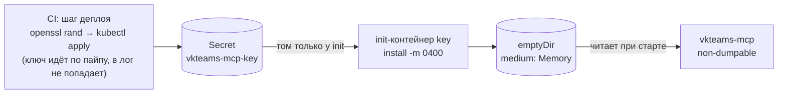
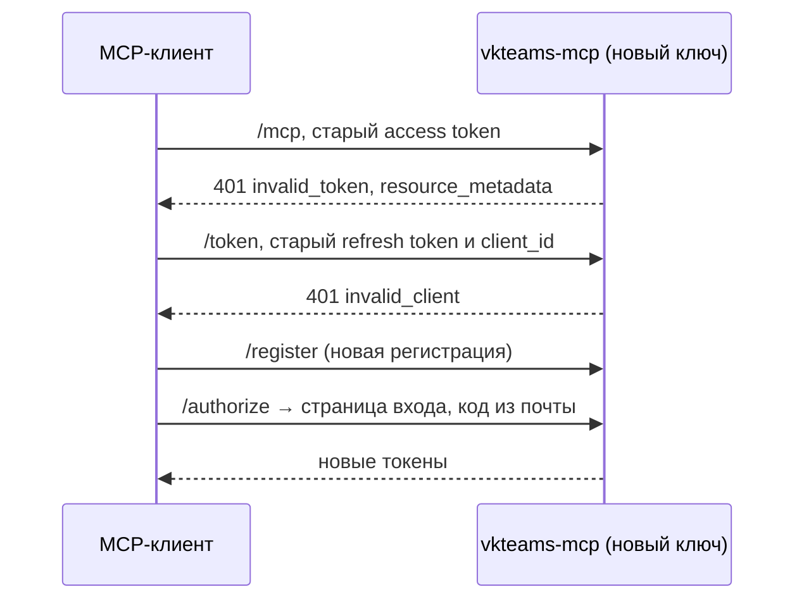

[English](README.en.md) | Русский

# Развёртывание в Kubernetes

Ключ, которым сервер шифрует сессии, не попадает ни в переменные окружения, ни в логи: `kubectl exec … env`
его не покажет. В контейнере сервера он лежит в одном файле в памяти (emptyDir `medium: Memory`), с правами
0400 только для пользователя сервера, а процесс закрыт от чтения памяти (`PR_SET_DUMPABLE=0`).



| Где | Есть ключ? |
|---|---|
| Secret `vkteams-mcp-key` | да — его пишет CI на каждом деплое |
| init-контейнер `key` | да, пока копирует, потом завершается |
| emptyDir `/run/vkteams-mcp/key` | да: 0400, владелец uid 10001; файл остаётся, чтобы рестарт контейнера сохранил сессии |
| том Secret в контейнере сервера | нет: Secret смонтирован только в init-контейнер |
| `env` контейнера сервера | нет: ни `env`, ни `envFrom` с ключом |
| логи | нет |
| память процесса сервера | да; другой процесс того же пользователя её не прочитает (non-dumpable) |

## Что делает деплой

| Событие | Ключ | Пользователи |
|---|---|---|
| деплой (новый ключ в Secret) | новый | **выходят все, один раз**: старые токены получают 401, клиент входит заново |
| рестарт или перенос пода без деплоя | тот же: init-контейнер копирует тот же Secret | остаются в системе |
| перезапуск контейнера внутри пода (OOM, падение, `livenessProbe`) | тот же файл в emptyDir | остаются в системе |

Реплик может быть сколько угодно: все поды одного деплоя читают один Secret. `strategy: Recreate` нужна,
чтобы во время выката не работали сразу два ключа: при `RollingUpdate` токен нового пода попадает на старый
и получает 401.

## Как выглядит выход после деплоя



Клиент, который на `invalid_client` не регистрируется заново, отправит человека на старую регистрацию. Тогда
браузер покажет страницу «Подключитесь заново»: в ИИ-приложении сбросить авторизацию коннектора и подключиться снова.

## Файлы

| Файл | Что это |
|---|---|
| [`kubernetes/deployment.yaml`](kubernetes/deployment.yaml) | Deployment с init-контейнером и Service |
| [`kubernetes/new-key.sh`](kubernetes/new-key.sh) | шаг деплоя для любого CI: новый ключ в Secret и рестарт подов |
| [`helm/secret.yaml`](helm/secret.yaml) | тот же Secret для чарта Helm или werf: новый ключ на каждом рендере |

## Любой CI

Деплой образа сам ключ не меняет: шаг `new-key.sh` нужно добавить в свой пайплайн деплоя, сразу после
применения манифестов.

```sh
kubectl -n vkteams apply -f deploy/kubernetes/deployment.yaml
NAMESPACE=vkteams deploy/kubernetes/new-key.sh
```

`new-key.sh` передаёт ключ от `openssl` в API Kubernetes через память шелла и пайп: его нет ни в файле, ни в
аргументах процессов, ни в логе; трассировку (`sh -x`) он выключает, ошибки `kubectl` не печатает (они могут
цитировать Secret). Secret пишется server-side apply, без аннотации `last-applied-configuration`, в которой
обычный `kubectl apply` хранит вторую копию ключа. Маскировать нечего. Если ваш CI всё же кладёт ключ в переменную, объявите её секретной
(masked в GitLab, `::add-mask::` в GitHub Actions).

## Helm и werf

Положите [`helm/secret.yaml`](helm/secret.yaml) в `templates/` рядом с Deployment и добавьте в шаблон пода:

```yaml
  template:
    metadata:
      annotations:
        checksum/vkteams-mcp-key: {{ include "vkteams-mcp.keyChecksum" . }}
```

Ключ создаёт `randAlphaNum 64` при каждом рендере, значит каждый `helm upgrade` или `werf converge` — новый
ключ, а изменившаяся аннотация перезапускает поды. Ключ не проходит через values, `--set` и лог CI.
`helm template` и `werf render` печатают его, как любой Secret: их вывод в лог не отправлять. История релизов
Helm и werf (Secret'ы `sh.helm.release.v1.*`) хранит ключ каждого прошлого деплоя; читают её те же, кто может
читать Secret'ы в namespace. Длину истории ограничивает `--history-max`.

## Переход с `VKTEAMS_MCP_SECRET`

| Версия | `VKTEAMS_MCP_SECRET` в env |
|---|---|
| 0.2.x | обязателен |
| 0.3.x | работает, если нет файла ключа, с предупреждением в логе; если файл есть — игнорируется |
| следующий минорный релиз | сервер не стартует |

Обновление образа без смены манифестов не уронит сервер и не разлогинит людей. Переход на init-контейнер —
это первый деплой с новым ключом: все выйдут один раз.

## Если сервер не стартует

| Сообщение в логе | Причина | Что делать |
|---|---|---|
| `no sealing key: /run/vkteams-mcp/key does not exist` | нет init-контейнера или emptyDir | добавить их, как в `deployment.yaml` |
| `the sealing key in … is readable by others` | файл доступен группе или всем: например, Secret смонтирован прямо в контейнер (`defaultMode` 0440/0644) | Secret — только в init-контейнер; файл кладёт `install -m 0400` |
| `the sealing key in … is not a regular file` | по пути каталог, FIFO или устройство | файл кладёт init-контейнер: `install -m 0400 /secret/key /run/vkteams-mcp/key` |
| `the sealing key in … belongs to uid …` | init-контейнер работал не от пользователя сервера | `runAsUser: 10001` на уровне пода, как в `deployment.yaml` |
| `the process could not be made non-dumpable … not starting` | ядро или seccomp-профиль запретили `prctl(PR_SET_DUMPABLE)` | разрешить `prctl` в профиле seccomp (в `RuntimeDefault` он разрешён) |
| `the sealing key in … could not be read` | по пути каталог или нет прав на чтение | проверить `install -m 0400` и `fsGroup: 10001` |
| `the sealing key must be at least 32 random characters` | в Secret пусто или короткий ключ | заново запустить `new-key.sh` |
| `the sealing key in … is not text` / `is longer than 4096 bytes` | в Secret не тот файл | заново запустить `new-key.sh` |
| `could not write secret/…` (в CI, от `new-key.sh`) | API отказал или не ответил вовремя; текст ошибки `kubectl` скрыт, он может цитировать ключ | проверить права и связь: `kubectl -n vkteams auth can-i patch secret/vkteams-mcp-key`. После таймаута Secret мог измениться: запустить `new-key.sh` ещё раз |
| `secret/… still has a last-applied-configuration annotation` (от `new-key.sh`) | не удалось снять аннотацию со старой копией ключа; поды не перезапущены | `kubectl -n vkteams annotate secret vkteams-mcp-key kubectl.kubernetes.io/last-applied-configuration-`, затем `new-key.sh` ещё раз |
| `VKTEAMS_MCP_SECRET is deprecated …` (предупреждение) | ключ ещё приходит переменной | перейти на init-контейнер, убрать переменную |
| `VKTEAMS_MCP_SECRET is ignored: the key comes from …` (предупреждение) | есть и файл, и переменная; работает файл | убрать переменную: `kubectl exec … env` всё ещё её показывает |

Ещё одно окно: между записью нового ключа в Secret и рестартом подов под, который перезапустится сам, возьмёт
уже новый ключ. Если `kubectl apply` изменил шаблон пода, его выкат может идти, пока `new-key.sh` пишет Secret,
и поды на миг окажутся с разными ключами. `new-key.sh` сразу делает рестарт, `Recreate` сначала гасит все
старые поды: после него ключ у всех один. Это внутри деплоя, который и так разлогинивает всех.

## Живая проверка

Проверено вживую 18.11.2026 на опубликованном образе 0.3.0 (`sha256:8a10645f…`) в кластере kind: ключа нет ни в `env`, ни в логах, файл ключа
`-r-------- 10001`, `/proc/1/environ` закрыт, тома Secret в контейнере сервера нет.
19.11.2026 на настоящем сервере VK Teams: вошедшая сессия пережила рестарт контейнера с тем же токеном; после
нового ключа старый токен получил `401 invalid_token` с `resource_metadata`, refresh — `401 invalid_client`,
повторный вход сработал. Как повторить (нужен человек, который дважды войдёт с кодом из почты) — в
[английской версии](README.en.md#live-proof).

## Что остаётся

| Угроза | Закрыто? |
|---|---|
| ключ в `kubectl exec … env`, в логах | да: ключа нет ни в переменных, ни в логах |
| ключ в томе Secret контейнера сервера | да: Secret смонтирован только в init-контейнер |
| память процесса через `/proc/<pid>/mem` или ptrace из другого процесса того же пользователя | да: процесс non-dumpable; на Linux без этого сервер не стартует. Проверка: `kubectl exec <под> -c vkteams-mcp -- cat /proc/1/environ` отвечает `Permission denied` |
| `kubectl exec` в контейнер сервера: `cat /run/vkteams-mcp/key` (тот же uid) | **нет**: закрывает RBAC на `pods/exec` у владельца кластера |
| ключ в Secret: кто может `get secrets` в namespace, читает его | **нет**: RBAC на `secrets` у владельца кластера |
