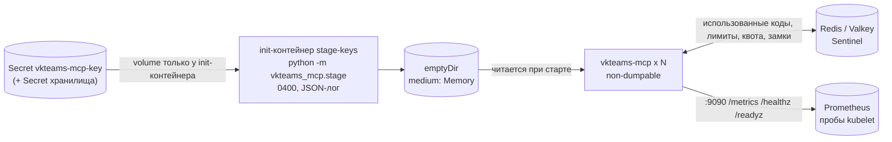

[English](README.en.md) | Русский

# Развёртывание в Kubernetes

Чарт [`charts/vkteams-mcp`](../charts/vkteams-mcp/README.md) запускает сервер в **нескольких репликах** с общим
хранилищем состояния (Redis или Valkey, одиночный или за Sentinel), JSON-логами, метриками Prometheus на отдельном
порту и ключом шифрования, который доставляется так, как ввела версия 0.3.0: ни в переменной окружения, ни в логе.

```sh
helm upgrade --install vkteams-mcp oci://ghcr.io/widmo-ru/charts/vkteams-mcp --version 0.4.0 -n vkteams -f values.yaml
```

```yaml
# values.yaml: минимум
publicUrl: https://vkteams-mcp.example.org
key:
  existingSecret: vkteams-mcp-key      # ваш Secret; scripts/new-sealing-key.sh создаёт его
state:
  sentinel: {hosts: ["redis-sentinel:26379"], master: mymaster}   # или: url: redis://redis:6379/0
vkteams:
  installations: [teams.example.org]   # привязать коннектор к вашему VK Teams
```



## Ключ шифрования

| Где | Ключ есть? |
|---|---|
| Secret (`key.existingSecret`, поле `key`) | да: Secret ваш |
| init-контейнер `stage-keys` | да, пока копирует, потом завершается |
| emptyDir `/run/vkteams-mcp/key` | да: 0400, владелец uid 10001; файл остаётся, перезапуск контейнера сессии сохраняет |
| Secret-том в контейнере сервера | нет: Secret монтируется только в init-контейнер |
| `env` контейнера сервера | нет |
| логи | нет |
| память процесса сервера | да; другой процесс того же пользователя её не прочитает (non-dumpable) |

**Ключ стабилен.** Он не меняется при деплое: это один и тот же Secret для каждого релиза, поэтому плавное
обновление (`maxUnavailable: 0`, `maxSurge: 1`) держит старые и новые поды рядом с одним ключом, и никого не разлогинивает.
Это отличие от 0.3.x, где Helm-вставка рисовала новый случайный ключ на каждый рендер. Положите Secret туда, где у вас
живут секреты (секретное значение werf, sealed или external secret) или создайте его
`scripts/new-sealing-key.sh <namespace> <secret>`: скрипт печатает идентификатор ревизии для `key.revision`.

**Смена ключа** — отдельная осознанная операция: запишите новое значение в Secret и задайте новый `key.revision`
(через аннотацию пода это перезапустит все поды). Все войдут заново, один раз; пока идёт обновление, токен, запечатанный
подом с новым ключом, отвергается подом со старым. Сервер знает один ключ, а не «предыдущий рядом»: обновление и есть
весь период перекрытия.

| Событие | Люди |
|---|---|
| деплой с тем же ключом | остаются в системе |
| под перезапущен или перепланирован | остаются в системе |
| контейнер перезапущен внутри пода | остаются в системе |
| ключ заменён | **разлогинены один раз**: старые токены получают 401 `invalid_token`, клиент входит заново |

## Хранилище состояния

Авторизация остаётся без состояния: сессии, черновики, ссылки на файлы едут запечатанными внутри того, что держит клиент.
В хранилище лежит только то, что при повторе надо отказать на любой реплике:

| Что | Ключ живёт | Значение |
|---|---|---|
| погашенный код авторизации | 5 минут | `1` |
| запросы кода входа на адрес и на сеть (3 и 10 в час) | 1 час | метки времени |
| неверные коды на шаг входа (5) | 15 минут | число |
| квота отправки на человека (10 сразу, 10 в минуту) | пока не наполнится | число и время |
| ссылка загрузки, пока идёт загрузка по ней | 10 минут | токен замка |

**Прочитать в нём нечего.** Каждый ключ — `<prefix><вид>:<HMAC-SHA256 значения под подключом ключа шифрования>`: ни
логина, ни адреса, ни IP, даже для того, кто читает хранилище. Значения — числа, метки времени и случайные токены.
У каждого ключа есть TTL. Запускайте хранилище с **`maxmemory-policy noeviction`**: вытесненный ключ снял бы лимит;
запись, отвергнутая из-за нехватки памяти, — ошибка хранилища и закрывается отказом. Хранилище может быть без пароля и
TLS (внутри сети платформы); если пароль есть, он берётся из файла.

| Настройка | Чарт | Окружение |
|---|---|---|
| один Redis или Valkey | `state.url: redis://host:6379/0` (или `rediss://`) | `VKTEAMS_MCP_STATE_URL` |
| Sentinel | `state.sentinel.hosts: [h1:26379, …]`, `.master: mymaster` (один хост допустим) | `VKTEAMS_MCP_STATE_SENTINELS`, `VKTEAMS_MCP_STATE_SENTINEL_MASTER` |
| база, TLS, ACL-пользователь | `state.db`, `state.tls`, `state.username` | `VKTEAMS_MCP_STATE_DB`, `_STATE_TLS`, `_STATE_USERNAME` |
| пароли | `state.existingSecret` с ключами `password`, `sentinelPassword` | `VKTEAMS_MCP_STATE_PASSWORD_FILE`, `_STATE_SENTINEL_PASSWORD_FILE` |
| префикс ключей | `state.prefix` (по умолчанию `vkteams:`) | `VKTEAMS_MCP_STATE_PREFIX` |

URL вместе с Sentinel — ошибка настройки, пароль в URL — тоже. Файлы с паролями кладёт тот же init-контейнер, что и ключ,
в тот же memory-том, с теми же проверками (обычный файл, только владелец, uid сервера, не больше 1 КиБ). Ничего не задано —
память: годится для **одной** реплики; чарт откажется от большего числа (`replicaCount > 1` или автомасштабирование без
хранилища), а сервер при старте пишет предупреждение.

**Когда хранилище недоступно:** вход, погашение кода и отправка закрываются отказом «попробуйте через минуту» (человека не
пропускают без лимита); чтение и списки работают. Готовность от хранилища **не** зависит (один сбой опустошил бы Service):
`mcp_state_store_up` становится 0 (алерт на него ставите вы). Переключение Sentinel подхватывается без
перезапуска: соединения истекают за 1 секунду, а мастер ищется заново.

## Пробы, метрики, ingress

| Порт | Отдаёт | Публичный? |
|---|---|---|
| 8000 | `/mcp`, OAuth, `/signin`, `/files/…`, `/healthz`, `/readyz` | только пути из ingress |
| 9090 (`metrics.port`) | `/metrics`, `/healthz`, `/readyz` | нет: только поды |

Пробы kubelet ходят на порт 9090. `/metrics` на публичном порту нет (404). Ingress перечисляет явные пути
(`ingress.paths`): `/mcp`, `/.well-known/`, `/authorize`, `/token`, `/register`, `/revoke`, `/signin`, `/static/`,
`/files/`; `/` чарт отвергает.

Метрики, у всех метка `server="vkteams"`: `mcp_http_requests_in_flight{route_group}`, `mcp_http_requests_total`,
`mcp_http_request_duration_seconds`, `mcp_tool_calls_total`, `mcp_tool_duration_seconds`,
`mcp_upstream_requests_total`, `mcp_upstream_duration_seconds`, `mcp_signin_total{result}`, `mcp_auth_refusals_total`,
`mcp_guard_refusals_total`, `mcp_link_transfers_total`, `mcp_state_store_up`, `mcp_state_store_errors_total`,
`mcp_state_store_duration_seconds`, `mcp_log_records_dropped_total`, `mcp_build_info{version}` и сборщики процесса и
Python. В метках никогда нет человека, адреса или аргумента инструмента. Снимайте метрики с подов на порту 9090;
`metrics.serviceMonitor.enabled` создаёт ServiceMonitor (kube-prometheus-stack) и Service `-metrics` для него. Стоит
алертить: `mcp_state_store_up == 0`, растущую долю 5xx в `mcp_http_requests_total`, `mcp_signin_total{result="limited"}`.

**Автомасштабирование выключено.** HPA по загрузке CPU конфликтует с VerticalPodAutoscaler, который задаёт CPU requests:
выберите одно. `autoscaling.inFlightPerPod` масштабирует по `mcp_http_requests_in_flight` через адаптер метрик, если он у вас
есть. CPU limit чарт не ставит.

**Логи** — один JSON-объект на строку от каждого процесса образа, включая init-контейнер и неудачный старт: `ts`, `level`,
`logger`, `event`, `msg`. `LOG_LEVEL` (`logLevel`, по умолчанию `INFO`) действует на все логгеры.

**За ingress** лимит запросов кода «на сеть» требует адрес клиента: `trustedProxies` (`VKTEAMS_MCP_TRUSTED_PROXIES`, CIDR
подов ingress-контроллера) разрешает этим прокси сообщать его в `X-Forwarded-For`. Без него лимит на сеть выключен (все
запросы были бы одним адресом), и сервер пишет об этом при старте; лимит на адрес остаётся.

**Загрузки и скачивания** идут через ingress: для ingress-nginx задайте `proxy-body-size` не меньше 100m,
`proxy-buffering: "off"` и `proxy-read-timeout` / `proxy-send-timeout` от 300. Чарт оставляет их пустыми; кладите их в
`ingress.annotations`.

**CA-бандл** для сервера VK Teams за внутренним CA: `vkteams.caBundle.configMap` и `.key` (`VKTEAMS_MCP_CA_BUNDLE`); он
заменяет корни, которым сервер доверяет для VK Teams, поэтому в нём должны быть все нужные CA.

Чарт не создаёт NetworkPolicy; `podLabels` позволяют собственной политике хранилища пропустить поды. `/tmp` — memory-том на
16Mi (`tmp.medium`, `tmp.sizeLimit`): загрузка файла держится в памяти, не на диске.

## Для проверки безопасности

| Вопрос | Ответ |
|---|---|
| Модели | нет: сервер не вызывает модель, это делает ИИ-приложение |
| Исходящие хосты | установка VK Teams, в которую входит человек, и хранилище состояния; больше ничего |
| Данные на входе | почта VK Teams и одноразовый код человека (только на странице входа), аргументы инструментов |
| Данные на выходе | результаты инструментов (помечены как данные), файлы по коротким ссылкам |
| В хранилище | ключи-HMAC; числа, метки времени, токены замков; TTL у каждого ключа; ни сессии, ни черновика, ни адреса, ни токена |
| В поде | ключ шифрования (0400, память), сессия VK Teams человека — только внутри его запечатанных токенов |
| Логи | JSON; без текста сообщений, имён, названий, адресов, кодов и токенов; запись, похожая на содержимое, отбрасывается и считается |
| Сообщить о дефекте | [SECURITY.md](../SECURITY.md) |

## Переменные окружения

Чарт задаёт их сам; вне чарта это интерфейс. Секреты — файлы, не переменные.

| Переменная | Смысл |
|---|---|
| `VKTEAMS_MCP_PUBLIC_URL` | https-адрес, по которому клиенты ходят к серверу (обязательна) |
| `VKTEAMS_MCP_KEY_FILE` | файл ключа (по умолчанию `/run/vkteams-mcp/key`) |
| `VKTEAMS_MCP_METRICS_PORT` | `/metrics`, `/healthz`, `/readyz` (по умолчанию 9090; никогда не публичный `PORT`) |
| `VKTEAMS_MCP_STATE_*` | хранилище, как в таблице выше |
| `VKTEAMS_MCP_TRUSTED_PROXIES` | CIDR, которым разрешено задавать `X-Forwarded-For` |
| `VKTEAMS_MCP_CA_BUNDLE` | файл CA для VK Teams |
| `LOG_LEVEL` | по умолчанию `INFO` |

## Файлы

| Файл | Что это |
|---|---|
| [`charts/vkteams-mcp`](../charts/vkteams-mcp/) | чарт, публикуется в `oci://ghcr.io/widmo-ru/charts/vkteams-mcp` |
| [`scripts/new-sealing-key.sh`](../scripts/new-sealing-key.sh) | создаёт Secret с новым ключом (один раз или для смены), печатает `key.revision` |
| [`scripts/chart-e2e.sh`](../scripts/chart-e2e.sh) | чарт в kind: 3 реплики, Valkey с Sentinel, поддельный VK Teams |
| [`scripts/state-tests.sh`](../scripts/state-tests.sh) | тесты хранилища на настоящих Valkey и Redis |

## Переход с 0.3.x

| Что | 0.3.x | 0.4.0 |
|---|---|---|
| манифесты | `deploy/kubernetes/deployment.yaml`, `new-key.sh`, `helm/secret.yaml` | чарт |
| ключ | новый случайный на каждый деплой | **стабильный**: ваш Secret; деплой никого не разлогинивает |
| реплики | работали, состояние в каждой (код можно было погасить в каждой, лимиты умножались на N) | общее хранилище; чарт не даёт много реплик без него |
| init-контейнер ключа | `install -m 0400` | `python -m vkteams_mcp.stage` (JSON-лог); кладёт и пароли хранилища |
| `VKTEAMS_MCP_SECRET` | работает с предупреждением, если нет файла ключа | **отвергается**: пока она задана, сервер не стартует |
| логи | `%`-шаблон, который ломала кавычка | JSON |

Переход с `VKTEAMS_MCP_SECRET`: (1) положите ключ в Secret в поле `key` (значение переменной и есть ключ; то же значение никого не разлогинивает), (2) разверните чартом или добавьте init-контейнер `python -m vkteams_mcp.stage /secret/key:/run/vkteams-mcp/key`, (3) уберите переменную из Deployment, `envFrom` и всего, что её задаёт.

Переход на чарт — один деплой с ключом из вашего Secret: если это не тот ключ, на котором работал прежний деплой, все
войдут заново один раз.

## Когда сервер не запускается

Каждая строка ниже — JSON-запись с `"event": "config_error"` в stderr; код выхода 2.

| `msg` | Причина | Что делать |
|---|---|---|
| `no sealing key: /run/vkteams-mcp/key does not exist` | нет init-контейнера или emptyDir | используйте чарт |
| `the sealing key in … is readable by others` | Secret смонтирован прямо в контейнер | Secret — только в init-контейнер |
| `the sealing key in … is not a regular file` / `belongs to uid …` / `could not be read` | не тот файл, владелец или права | init-контейнер работает от uid 10001 (`runAsUser`) и пишет файл |
| `the sealing key must be at least 32 random characters` / `is not text` / `is longer than 4096 bytes` | не то значение в Secret | `scripts/new-sealing-key.sh` |
| `VKTEAMS_MCP_STATE_URL and VKTEAMS_MCP_STATE_SENTINELS are both set` | заданы оба | одно из двух |
| `VKTEAMS_MCP_STATE_URL carries a user or password` | пароль в переменной | `state.username` и `state.existingSecret` |
| `the state store password in … is readable by others` / `does not exist` | плохой файл пароля | его кладёт init-контейнер; в Secret нужен ключ `password` |
| `VKTEAMS_MCP_STATE_… is set but there is no VKTEAMS_MCP_STATE_URL` | настройка хранилища без хранилища | задайте URL или Sentinel |
| `VKTEAMS_MCP_METRICS_PORT is the public port` | один и тот же порт | другой порт |
| `the process could not be made non-dumpable … not starting` | профиль seccomp отказал `prctl` | `RuntimeDefault` разрешает |
| `stage_failed` (init-контейнер, код 2) | в Secret нет ключа | поле `key.secretKey` у `key.existingSecret` |
| `VKTEAMS_MCP_SECRET is no longer accepted …` | ключ всё ещё приходит переменной | миграция выше, затем уберите переменную |

## Что остаётся

| Угроза | Закрыта? |
|---|---|
| ключ в `kubectl exec … env`, в логах | да |
| ключ в Secret-томе контейнера сервера | да: только init-контейнер |
| память процесса через `/proc/<pid>/mem` или ptrace от того же пользователя | да: non-dumpable |
| лимит, снятый сбросом или вытеснением хранилища | частично: `noeviction`, TTL у каждого ключа; сброшенное хранилище обнуляет счётчики |
| `kubectl exec` в контейнер сервера и чтение ключа (тот же uid) | **нет**: RBAC на `pods/exec`, сторона владельца кластера |
| кто может `get secrets` в пространстве имён, читает ключ | **нет**: RBAC на `secrets` |

## Доказательство

`scripts/chart-e2e.sh` идёт в CI на каждый pull request: три реплики, Valkey с Sentinel (с паролями), поддельный VK Teams.
Проверяет, что код, погашенный на одном поде, отвергается на остальных; что запросы кода и неверные коды считаются
общими; что заморозка мастера Valkey закрывает вход отказом и переключается за 30 секунд; что `/metrics` только на 9090;
что каждая строка лога каждого контейнера — JSON; что HPA рендерится и показывает цель. Ключевая схема 0.3.0 была доказана
вживую на настоящем VK Teams 2026-11-19 (сессия пережила перезапуск контейнера; новый ключ отверг старые токены с
`invalid_token` и `invalid_client`); запись и шаги — в заметках релиза 0.3.0 и `tests/live/e2e_oauth.py`.
