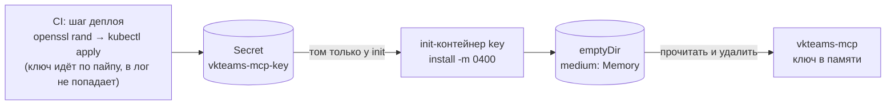
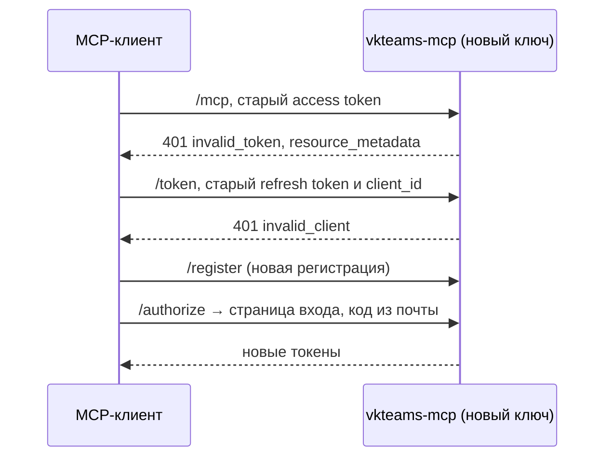

[English](README.en.md) | Русский

# Развёртывание в Kubernetes

Ключ, которым сервер шифрует сессии, живёт только в памяти процесса. В контейнере сервера его нет ни в
переменных окружения, ни в файлах: `kubectl exec … env` и `ls` его не покажут.



| Где | Есть ключ? |
|---|---|
| Secret `vkteams-mcp-key` | да — его пишет CI на каждом деплое |
| init-контейнер `key` | да, пока копирует, потом завершается |
| emptyDir `/run/vkteams-mcp` | только до старта сервера: он читает файл и удаляет его |
| `env` контейнера сервера | нет: ни `env`, ни `envFrom` с ключом |
| память процесса сервера | да, и только там |

## Что делает деплой

| Событие | Ключ | Пользователи |
|---|---|---|
| деплой (новый ключ в Secret) | новый | **выходят все, один раз**: старые токены получают 401, клиент входит заново |
| рестарт или перенос пода без деплоя | тот же: init-контейнер копирует тот же Secret | остаются в системе |
| перезапуск контейнера внутри того же пода | файла уже нет | сервер не стартует и пишет, что под надо удалить: `kubectl delete pod …` |

Поэтому в примере нет `livenessProbe`: она перезапускала бы контейнер внутри пода, а не под целиком.

Реплик может быть сколько угодно: все поды одного деплоя читают один Secret. `strategy: Recreate` нужна,
чтобы во время выката не работали сразу два ключа: при `RollingUpdate` токен нового пода попадает на старый
и получает 401.

## Как выглядит выход после деплоя



Клиент, который на `invalid_client` не регистрируется заново, отправит человека на старую регистрацию. Тогда
браузер покажет страницу «Подключитесь заново»: в ИИ-приложении сбросить авторизацию коннектора и подключиться снова.

## Файлы

| Файл | Что это |
|---|---|
| [`kubernetes/deployment.yaml`](kubernetes/deployment.yaml) | Deployment с init-контейнером и Service |
| [`kubernetes/new-key.sh`](kubernetes/new-key.sh) | шаг деплоя для любого CI: новый ключ в Secret и рестарт подов |
| [`helm/secret.yaml`](helm/secret.yaml) | тот же Secret для чарта Helm или werf: новый ключ на каждом рендере |

## Любой CI

Деплой образа сам ключ не меняет: шаг `new-key.sh` нужно добавить в свой пайплайн деплоя, сразу после
применения манифестов.

```sh
kubectl -n vkteams apply -f deploy/kubernetes/deployment.yaml
NAMESPACE=vkteams deploy/kubernetes/new-key.sh
```

`new-key.sh` передаёт ключ от `openssl` в API Kubernetes через память шелла и пайп: его нет ни в файле, ни в
аргументах процессов, ни в логе; трассировку (`sh -x`) он выключает, ошибки `kubectl` не печатает (они могут
цитировать Secret). Secret пишется server-side apply, без аннотации `last-applied-configuration`, в которой
обычный `kubectl apply` хранит вторую копию ключа. Маскировать нечего. Если ваш CI всё же кладёт ключ в переменную, объявите её секретной
(masked в GitLab, `::add-mask::` в GitHub Actions).

## Helm и werf

Положите [`helm/secret.yaml`](helm/secret.yaml) в `templates/` рядом с Deployment и добавьте в шаблон пода:

```yaml
  template:
    metadata:
      annotations:
        checksum/vkteams-mcp-key: {{ include "vkteams-mcp.keyChecksum" . }}
```

Ключ создаёт `randAlphaNum 64` при каждом рендере, значит каждый `helm upgrade` или `werf converge` — новый
ключ, а изменившаяся аннотация перезапускает поды. Ключ не проходит через values, `--set` и лог CI.
`helm template` и `werf render` печатают его, как любой Secret: их вывод в лог не отправлять. История релизов
Helm и werf (Secret'ы `sh.helm.release.v1.*`) хранит ключ каждого прошлого деплоя; читают её те же, кто может
читать Secret'ы в namespace. Длину истории ограничивает `--history-max`.

## Переход с `VKTEAMS_MCP_SECRET`

| Версия | `VKTEAMS_MCP_SECRET` в env |
|---|---|
| 0.2.x | обязателен |
| 0.3.x | работает, если нет файла ключа, с предупреждением в логе; если файл есть — игнорируется |
| следующий минорный релиз | сервер не стартует |

Обновление образа без смены манифестов не уронит сервер и не разлогинит людей. Переход на init-контейнер —
это первый деплой с новым ключом: все выйдут один раз.

## Если сервер не стартует

| Сообщение в логе | Причина | Что делать |
|---|---|---|
| `no sealing key: /run/vkteams-mcp/key does not exist` | контейнер перезапущен внутри того же пода (файл уже прочитан и удалён) или init-контейнера нет | `kubectl delete pod <под>`: новый под скопирует тот же ключ; без init-контейнера — добавить его |
| `the sealing key in … could not be deleted` | Secret смонтирован прямо в контейнер сервера, том только для чтения | Secret — только в init-контейнер, серверу — emptyDir `medium: Memory` |
| `the sealing key in … could not be read` | по пути каталог или нет прав на чтение | проверить `install -m 0400` и `fsGroup: 10001` |
| `the sealing key must be at least 32 random characters` | в Secret пусто или короткий ключ | заново запустить `new-key.sh` |
| `the sealing key in … is not text` / `is longer than 4096 bytes` | в Secret не тот файл | заново запустить `new-key.sh` |
| `VKTEAMS_MCP_SECRET is deprecated …` (предупреждение) | ключ ещё приходит переменной | перейти на init-контейнер, убрать переменную |
| `VKTEAMS_MCP_SECRET is ignored: the key comes from …` (предупреждение) | есть и файл, и переменная; работает файл | убрать переменную: `kubectl exec … env` всё ещё её показывает |

Почему под не восстанавливается сам: Kubernetes перезапускает упавший контейнер, но не init-контейнер.
Восстановить ключ внутри пода значит хранить его там, где его видит `kubectl exec`, — это ровно то, от чего
это устройство защищает. Цена: при падении процесса (в том числе OOM) под остаётся в CrashLoopBackOff, пока его
не удалят. Следите за рестартами контейнера.

Ещё одно окно: между записью нового ключа в Secret и рестартом подов под, который перезапустится сам, возьмёт
уже новый ключ. Если `kubectl apply` изменил шаблон пода, его выкат может идти, пока `new-key.sh` пишет Secret,
и поды на миг окажутся с разными ключами. `new-key.sh` сразу делает рестарт, `Recreate` сначала гасит все
старые поды: после него ключ у всех один. Это внутри деплоя, который и так разлогинивает всех.

## Что остаётся

| Угроза | Закрыто? |
|---|---|
| ключ в `kubectl exec … env`, в `ls`, в логах | да, этим устройством |
| ключ в Secret: кто может `get secrets` в namespace, читает его | нет: это RBAC кластера, сторона владельца кластера |
| `pods/exec` от того же пользователя: можно прочитать память процесса | нет: это доступ к самому процессу |
